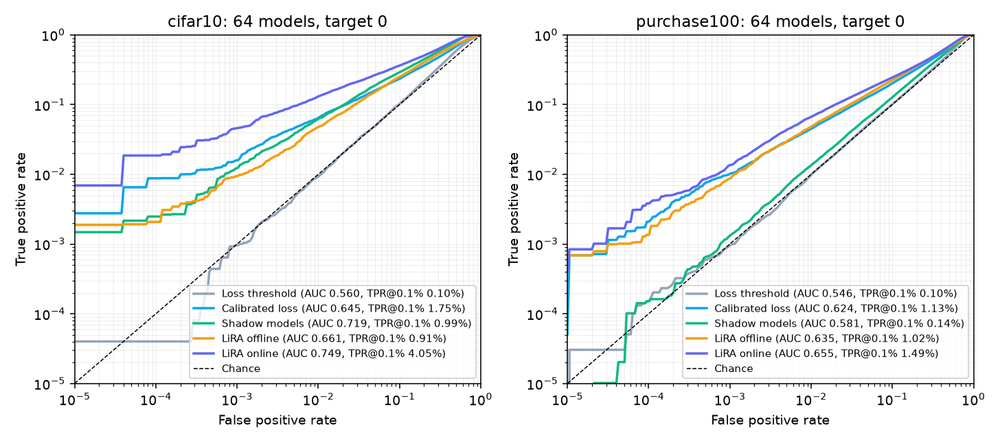
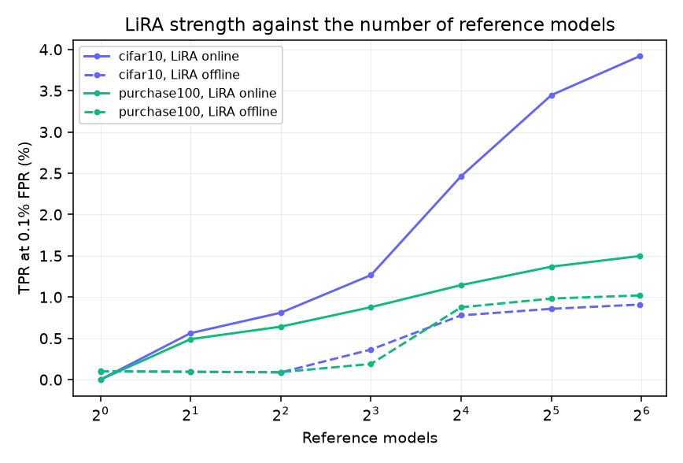
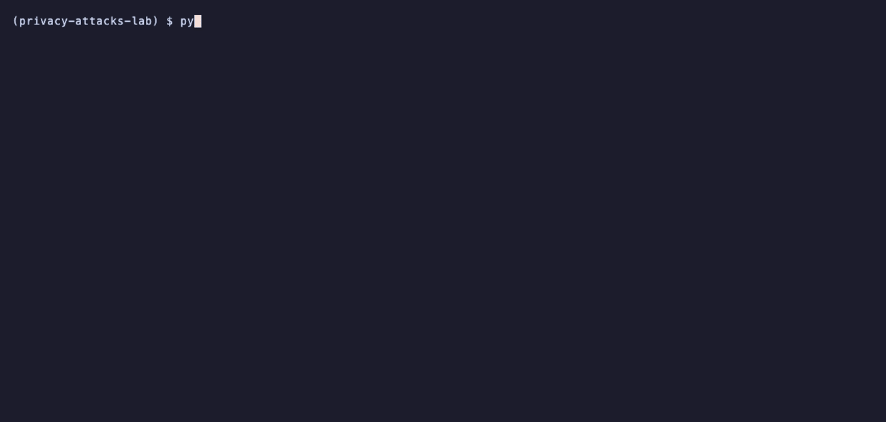
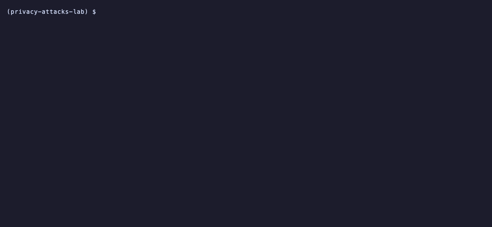
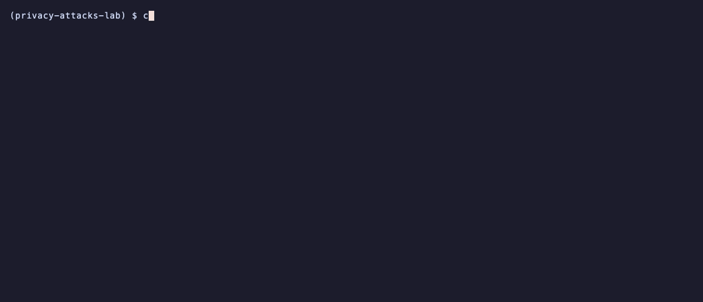

<h1 align="center">Privacy Attacks Lab</h1>

<p align="center">
  <em>Membership inference attacks (LiRA, shadow models, calibrated loss), DP-SGD with RDP and PRV accountants checked against Opacus, and canary exposure and extraction from small language models.</em>
</p>

<p align="center">
  <a href="https://github.com/adeoluo/privacy-attacks-lab/actions/workflows/ci.yml"></a>
  <a href="https://github.com/adeoluo/privacy-attacks-lab/releases"></a>
  
  
  <a href="LICENSE"></a>
</p>

---

## Motivation

A model that has seen a record behaves slightly differently on it, and that difference can reveal
who was in the training set or reproduce text that was meant to stay private. The useful question
is not the average-case accuracy of such an attack but how many members it identifies with almost
no false positives, which is where real harm happens (Carlini et al. 2022). Answering it needs
many models trained on known subsets of the data, a careful attack, and ROC metrics read at 0.1%
and 1% false positive rate.

This lab implements the attacks (loss threshold, difficulty calibrated loss, shadow models, LiRA
online and offline), the defence (DP-SGD with per-example clipping and Poisson sampling) and the
privacy accounting behind its guarantee (RDP, PRV and GDP accountants, with RDP and ROC analysis in
a Rust core). Every accountant is checked against Opacus to many digits, the LiRA scores are checked
against the authors' released scoring code, and every number below comes from runs on the full
CIFAR-10 and Purchase100 datasets with 64 models each.

## Architecture

<p align="center">
  
</p>

<sub>Legend: amber = entry points and external systems, indigo = core logic, green = data and state, blue = validation and control, grey = observability and outputs.</sub>

Benchmarks and the CLI choose a dataset preset; the shadow harness trains a family of models,
each on a seeded random half of the pool, records the membership masks and every model's logits
on every example (the run store), and the attacks score each target model using the others as
references (leave one out, [ADR-0002](docs/adr/0002-lira-leave-one-out-model-family.md)). DP-SGD
trains the same families with noise calibrated by the accountants. The Rust core computes ROC
curves, TPR at fixed FPR and bootstrap intervals; results land in `benchmarks/results/` as JSON
and the HTTP service exposes accounting, ROC metrics and exposure with Prometheus metrics.

## Results

All runs: Apple M1 (8 cores, 8 GB, MPS), shared with other work. Each dataset's pool is split at
random into halves 64 times; each model trains on its half, so every example is a member of about
32 models and a non-member of the other 32. Every model in turn is the target and the other 63 are
the attacker's reference models. Tables give the mean over 16 target models (standard deviation
in parentheses); per-target bootstrap intervals (1,000 resamples) are in the result files.

### Membership inference on CIFAR-10 (50,000 images, 64 CNNs)

GroupNorm CNN (0.11M parameters), 15 epochs on 25,000 images each, no augmentation in training;
train accuracy 98.5%, held-out accuracy 75.5%. Queries: the image and its mirror. 1.6 hours to
train all 64 models.

| Attack | AUC | TPR at 0.1% FPR | TPR at 1% FPR |
|---|---:|---:|---:|
| Loss threshold (Yeom et al. 2018) | 56.0% (0.3) | 0.10% (0.02) | 1.02% |
| Calibrated loss (Watson et al. 2022) | 64.5% (0.5) | 1.75% (0.27) | 6.10% |
| Shadow models (Shokri et al. 2017) | 71.9% (1.2) | 0.99% (0.17) | 5.68% |
| LiRA offline, fixed variance | 66.1% (0.7) | 0.91% (0.16) | 4.79% |
| LiRA online, per-example variance | 74.7% (0.9) | 3.27% (0.48) | 10.71% |
| **LiRA online, fixed variance** | **74.9% (0.8)** | **4.05% (0.76)** | **12.04%** |
| LiRA online, authors' scoring code | 74.8% (0.9) | 3.27% (0.51) | 10.78% |

### Membership inference on Purchase100 (197,324 records, 64 MLPs)

MLP 600-512-256-128-100 (0.48M parameters), 20 epochs on 98,662 records each; train accuracy
99.8%, held-out accuracy 93.0%. 34 minutes to train all 64 models.

| Attack | AUC | TPR at 0.1% FPR | TPR at 1% FPR |
|---|---:|---:|---:|
| Loss threshold | 54.6% (0.1) | 0.10% (0.01) | 1.00% |
| Calibrated loss | 62.4% (0.1) | 1.13% (0.10) | 4.69% |
| Shadow models | 58.1% (0.2) | 0.14% (0.02) | 1.34% |
| LiRA offline, fixed variance | 63.5% (0.1) | 1.02% (0.10) | 5.03% |
| LiRA online, per-example variance | 65.1% (0.1) | 1.30% (0.09) | 5.87% |
| **LiRA online, fixed variance** | **65.5% (0.1)** | **1.49% (0.14)** | **6.66%** |
| LiRA online, authors' scoring code | 65.2% (0.1) | 1.32% (0.09) | 5.90% |

Reproduce: `python benchmarks/train_shadows.py cifar10` then `python benchmarks/mia_benchmark.py
cifar10` (same for `purchase100`). Raw results: [`mia_cifar10.json`](benchmarks/results/mia_cifar10.json),
[`mia_purchase100.json`](benchmarks/results/mia_purchase100.json).

<p align="center">
  
</p>

### Comparison with references

| Check | Reference | Result | Verdict |
|---|---|---|---|
| LiRA online scores | Authors' released scoring (`lira-online-ref`), same logits | AUC 74.7% vs 74.8% (CIFAR-10), 65.1% vs 65.2% (Purchase100); TPR at 0.1% FPR 3.27% vs 3.27%, 1.30% vs 1.32% | tie |
| LiRA offline scores | Authors' offline scoring (two-sided) | 66.0% vs 57.6% AUC on CIFAR-10; the one-sided test here is stronger | win |
| CIFAR-10 LiRA online, TPR at 0.1% FPR | Carlini et al. 2022, Table I: 8.4% (WRN, 256 shadow models, augmented queries; quoted, not rerun) | 4.05% with a 0.11M CNN, 63 references, 2 queries | loss (smaller model and fewer references; the scaling curve is still rising at 63) |
| Purchase100 LiRA online, TPR at 0.1% FPR | Carlini et al. 2022, Table VIII: 4.1% (quoted, not rerun) | 1.49% with a regularised MLP at 93.0% held-out accuracy | loss (less overfit target) |
| RDP epsilon, 48 settings | Opacus 1.6 `RDPAccountant` | max relative difference 4.2e-12 (Rust), 1.6e-12 (NumPy) | tie |
| PRV epsilon, 41 settings | Opacus 1.6 `PRVAccountant` | max relative difference 2.1e-8, median 3.9e-10 | tie |
| Noise calibration, 12 settings | Opacus `get_noise_multiplier` | max relative sigma difference 3.2e-5 (Opacus stops at an epsilon tolerance of 1e-4) | tie |
| ROC AUC, 100,000 scores | scikit-learn `roc_curve` + `auc` | absolute difference 1.1e-16 | tie |

### Speed of the Rust core

Median wall time per call, `python benchmarks/parity_speed.py`
([`parity_speed.json`](benchmarks/results/parity_speed.json)).

| Operation | Rust core | NumPy reference | Library |
|---|---:|---:|---:|
| RDP epsilon (q 0.004, sigma 1.1, 7,500 steps) | **0.81 ms** | 12.1 ms | 22.7 ms (Opacus) |
| Noise calibration to epsilon 3 | **18 ms** | 778 ms | |
| ROC summary, 100,000 scores | **21 ms** | 54 ms | 60 ms (scikit-learn) |
| Bootstrap, 1,000 replicates of 100,000 scores | **7.9 s** | 32.6 s | |

### Number of reference models

TPR at 0.1% FPR of LiRA online (fixed variance) as the attacker trains more reference models (8
targets each): CIFAR-10 0.56% (2), 1.27% (8), 2.47% (16), 3.45% (32), 3.92% (63); Purchase100
0.49% (2), 0.88% (8), 1.15% (16), 1.37% (32), 1.50% (63).

<p align="center">
  
</p>

Full method, ablations and threats to validity: [`docs/EVALUATION_REPORT.md`](docs/EVALUATION_REPORT.md).

## Quickstart

```bash
git clone https://github.com/adeoluo/privacy-attacks-lab && cd privacy-attacks-lab
uv sync --all-extras --dev --group validation   # builds the Rust core with maturin
uv run python -m privacy_attacks_lab epsilon --q 0.004 --sigma 1.1 --epochs 30
make test
```

Requires Python 3.11 or 3.12, a Rust toolchain and [uv](https://docs.astral.sh/uv/). Without the
Rust core the package falls back to the NumPy implementations.

## Usage

### Command line

```bash
python -m privacy_attacks_lab epsilon --q 0.004 --sigma 1.1 --epochs 30 --accountant prv
python -m privacy_attacks_lab calibrate --q 0.004 --epochs 30 --target-epsilon 1
python -m privacy_attacks_lab max-tpr --epsilon 1            # TPR bound implied by (eps, delta)-DP
python -m privacy_attacks_lab report benchmarks/results/mia_cifar10.json --sort tpr@0.001
python -m privacy_attacks_lab serve --port 8000
```

### Library

```python
from privacy_attacks_lab.accountants import epsilon, calibrate_noise
from privacy_attacks_lab import metrics

eps = epsilon(q=256 / 50_000, sigma=1.1, steps=5_860, delta=1e-5, accountant="prv")
sigma = calibrate_noise(8.0, 1e-5, q=1_024 / 98_662, steps=2_880)
summary = metrics.summarize(scores, is_member)  # AUC, balanced accuracy, TPR at low FPR
intervals = metrics.bootstrap(scores, is_member, reps=1_000)
```

Training families and attacking them:

```bash
scripts/download_data.sh                                  # CIFAR-10, Purchase100, Texas100, WikiText-2
python benchmarks/train_shadows.py purchase100            # 64 models into $PAL_DATA_DIR/runs/
python benchmarks/mia_benchmark.py purchase100            # attack table, ROC, bootstrap, scaling
python benchmarks/dp_utility.py purchase100 --eps 1 2 4 8 --seeds 0 1 2
python benchmarks/lm_canaries.py --models base ft dp8     # canary exposure and extraction
python benchmarks/figures.py                              # figures from committed results
```

### HTTP service

`GET /health`, `GET /ready`, `GET /metrics` (Prometheus text), and JSON `POST /epsilon`,
`/calibrate`, `/max-tpr`, `/roc` and `/exposure`. Standard library server, 8 MB body limit,
binds to 127.0.0.1 by default.

```bash
curl -s localhost:8000/epsilon -d '{"q": 0.004, "sigma": 1.1, "steps": 7500}'
curl -s localhost:8000/roc -d '{"scores": [0.9, 0.2, 0.7, 0.1], "labels": [1, 0, 1, 0]}'
```

### Demos

Recorded from real runs with [vhs](https://github.com/charmbracelet/vhs); each tape is in `docs/demo/`.

Privacy accounting: epsilon of a DP-SGD schedule, the noise for a target epsilon, and the attack TPR that epsilon allows.

<p align="center">
  
</p>

Attack tables from the committed CIFAR-10 and Purchase100 results, sorted by TPR at 0.1% FPR.

<p align="center">
  
</p>

The HTTP service: readiness, epsilon from three accountants, canary exposure, and request metrics.

<p align="center">
  
</p>

## Design decisions

- **One family of 64 models, leave one out** instead of separate shadow and target models: every
  model is a target once, so 16 targets cost no extra training ([ADR-0002](docs/adr/0002-lira-leave-one-out-model-family.md)).
- **DP-SGD with per-sample gradients from hooks, Poisson sampling, GroupNorm** instead of shuffled
  batches or BatchNorm, so the training matches the accountant's assumptions ([ADR-0003](docs/adr/0003-dpsgd-per-sample-gradients.md)).
- **RDP in Rust, PRV in NumPy, both validated against Opacus**; RDP and ROC are hot loops in
  calibration and bootstrap, PRV is FFT bound ([ADR-0004](docs/adr/0004-accountants-rdp-prv-rust.md)).
- **Exact canary exposure by enumeration** on Pythia-70M rather than the skew-normal estimate
  alone, so the estimator's error is measured ([ADR-0005](docs/adr/0005-exact-canary-exposure.md)).
- **Fixed-variance LiRA reported next to per-example variance**: with 63 references the fixed
  variance is stronger at 0.1% FPR on both datasets, matching the paper's advice for few models.

## Testing

```bash
make test        # unit, property-based, integration (CLI and HTTP)
make coverage    # with the 80% gate used in CI
make parity      # Rust core against the NumPy reference
make validate    # accountants against Opacus, ROC against scikit-learn
make rust-check  # cargo fmt, clippy and the Rust unit tests
```

348 Python tests (98% line coverage in CI) and 13 Rust tests: property-based tests with
hypothesis (accountant monotonicity, ROC invariants, exposure bounds), Opacus parity of RDP, PRV
and calibration, Rust against NumPy parity, DP-SGD per-sample gradients against explicit
per-example backward passes and against Opacus, LiRA against the authors' scoring, CLI and HTTP
integration tests.
CI runs on Python 3.11 and 3.12 with small fixtures; full-scale runs are the benchmark scripts.

## Responsible AI

- **Model card:** [`docs/MODEL_CARD.md`](docs/MODEL_CARD.md)
- **Data card:** [`docs/DATA_CARD.md`](docs/DATA_CARD.md)
- **Threat model:** [`docs/THREAT_MODEL.md`](docs/THREAT_MODEL.md)

The attacks only target models this project trains on public benchmark data; the canaries are
fictional names and random digits. Attack success is an empirical lower bound on leakage, never a
proof of privacy; only the DP-SGD guarantee is a bound.

## Limitations

- Models are small (0.11M and 0.48M parameters) to train 64 of each on an 8 GB M1; larger models
  memorise more, so the TPRs here understate what LiRA achieves on WRN-sized models.
- 64 models per dataset, not the paper's 256; the reference-count curve is still rising at 63.
- Texas100 is downloaded and supported by the loader and presets but was not benchmarked.
- The attacker knows the exact training recipe and data pool, a strong and favourable setting.
- Wall-clock timings were taken on a machine shared with other jobs and vary between runs.

## Roadmap

- [ ] Texas100 family of 64 models.
- [ ] 256 reference models on CIFAR-10 with a WRN-16-4, as in the LiRA paper.
- [ ] Auditing DP-SGD with canary gradients (lower bounds on epsilon from attacks).

## License

Released under the [MIT License](LICENSE).
